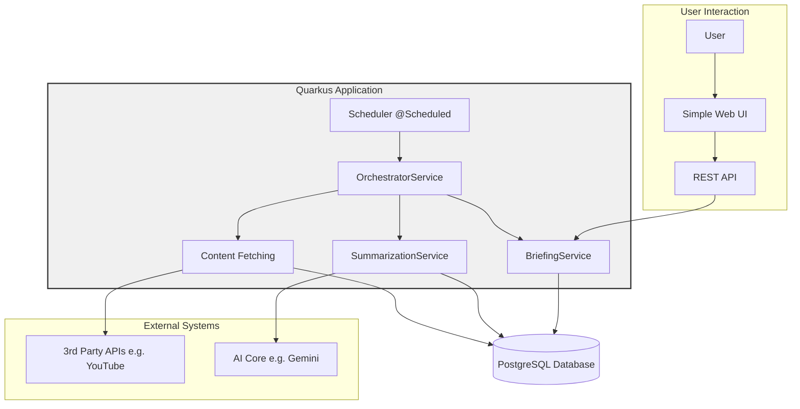

# Povzetkar

## About The Project

This project is an autonomous, AI-powered intelligence platform. It automatically fetches content from various sources (starting with YouTube), generates summaries using generative AI, and aggregates them into daily briefings. The entire system is built as a modern, cloud-native **Quarkus** application.

The application is fully automated, from data ingestion to the final presentation of briefings through a simple web interface.

### Architecture

The architecture is a single, self-contained Quarkus application.



## Getting Started

To get a local copy up and running, follow these simple steps.

### Prerequisites

*   Java 25+ (preferably GraalVM)
*   Docker
*   An IDE (e.g., IntelliJ IDEA, VS Code)
*   Google Cloud SDK (for authentication if using Google GenAI)
*   A YouTube Data API Key

### Running the Application

1.  **Clone the repository:**
    ```bash
    git clone <repository-url>
    cd povzetkar
    ```

2.  **Start the Database:**
    Navigate to the backend directory and start the PostgreSQL database.
    ```bash
    cd backend
    docker compose up -d
    ```

3.  **Set Environment Variables:**
    Create a `.env` file in the `backend/` directory with the necessary credentials. See `RUNBOOK.md` for details.

4.  **Run the Quarkus Application:**
    In a separate terminal, run the Quarkus application in development mode.
    ```sh
    ./mvnw quarkus:dev -pl backend
    ```

## Project Documentation Hub

This repository follows a mandatory modular documentation standard. Use the table below to navigate the system's "Source of Truth".

| Domain | Description | Key Artifacts |
|:---|:---|:---|
| 🎯 **Strategy** | Vision, Roadmap & Concepts | [Overview](./docs/overview/), [Roadmap](./docs/overview/roadmap.md), [Concepts](./docs/overview/concepts.md), [Principles](./AGENT.md) |
| 🏗️ **Engineering** | Technical Decisions & Blueprints | [ADRs](./docs/adr/), [API Design](./docs/analysis/api-design.md), [Planning Protocol](./docs/process/planning_protocol.md) |
| 🔍 **Analysis** | Requirements & Traceability | [Use Cases](./docs/analysis/use_cases.md), [Test Specification](./docs/analysis/test_specification.md) |
| 🛠️ **SDLC & Ops** | Maintenance & Framework | [SDLC Repository](./docs/sdlc/), [Checklist](./docs/sdlc/11_development_checklist.md), [NFRs](./docs/sdlc/02_non_functional_requirements.md), [Runbook](./docs/RUNBOOK.md) |
| 📦 **Versions** | Active Cycle & Archives | [v0.16.0 Hub](./docs/versions/v0.16.0/v0.16.0-planning-process.md), [v0.15.0 Tasks](./docs/versions/v0.15.0-tasks.md) |
| 🕰️ **History** | Learnings & Growth | [Retrospectives](./docs/retrospectives/), [Backlog](./docs/backlog/), [Spikes](./docs/spikes/) |

> [!TIP]
> Exploring the complete system? Visit the [**Full Documentation Root**](./docs/) for all technical guides, knowledge items, and research spikes.

### 🚀 Current Cycle: v0.16.0 (User Experience Focus)
- **Active Plan**: [Planning Hub (v0.16.0)](./docs/versions/v0.16.0/v0.16.0-planning-process.md)
- **Execution Roadmap**: [Task List (v0.16.0)](./docs/versions/v0.16.0/v0.16.0-tasks.md)
- **Design Blueprint**: [UI/UX Manifesto (v0.16.0)](./docs/versions/v0.16.0/v0.16.0-ui-ux-manifesto.md)
- **Localization**: [i18n Audit (v0.16.0)](./docs/versions/v0.16.0/v0.16.0-i18n-audit.md)

---

### API Documentation (Development Mode)
Access the interactive documentation at:
- **Swagger UI:** [http://localhost:8080/q/swagger-ui](http://localhost:8080/q/swagger-ui)
- **OpenAPI Schema:** [http://localhost:8080/q/openapi](http://localhost:8080/q/openapi)

> [!IMPORTANT]
> Swagger UI is strictly **disabled** in production profiles for security.
