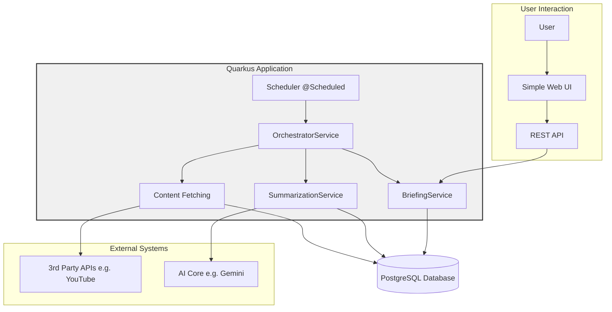

# Povzetkar

## About The Project

This project is an autonomous, AI-powered intelligence platform. It automatically fetches content from various sources (starting with YouTube), generates summaries using generative AI, and aggregates them into daily briefings. The entire system is built as a modern, cloud-native **Quarkus** application.

The application is fully automated, from data ingestion to the final presentation of briefings through a simple web interface.

### Architecture

The architecture is a single, self-contained Quarkus application.



## Getting Started

To get a local copy up and running, follow these simple steps.

### Prerequisites

*   Java 21+ (preferably GraalVM)
*   Docker
*   An IDE (e.g., IntelliJ IDEA, VS Code)
*   Google Cloud SDK (for authentication if using Google GenAI)
*   A YouTube Data API Key

### Running the Application

1.  **Clone the repository:**
    ```bash
    git clone <repository-url>
    cd povzetkar
    ```

2.  **Start the Database:**
    This command will start the PostgreSQL database in a Docker container.
    ```bash
    docker compose up -d
    ```

3.  **Set Environment Variables:**
    Create a `.env` file in the project root with the necessary credentials. See `RUNBOOK.md` for details.

4.  **Run the Quarkus Application:**
    In a separate terminal, run the Quarkus application in development mode.
    ```sh
    ./mvnw quarkus:dev
    ```

## Documentation

For more detailed information, please refer to the documents in the [`/docs`](docs) folder.

### API Documentation (Swagger UI)

When running in development mode, you can access the interactive API documentation at:
*   **Swagger UI:** [http://localhost:8080/q/swagger-ui](http://localhost:8080/q/swagger-ui)
*   **OpenAPI Schema:** [http://localhost:8080/q/openapi](http://localhost:8080/q/openapi)

> [!IMPORTANT]
> Swagger UI is strictly **disabled** in the production profile for security.
