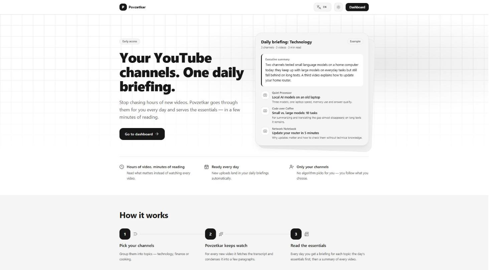
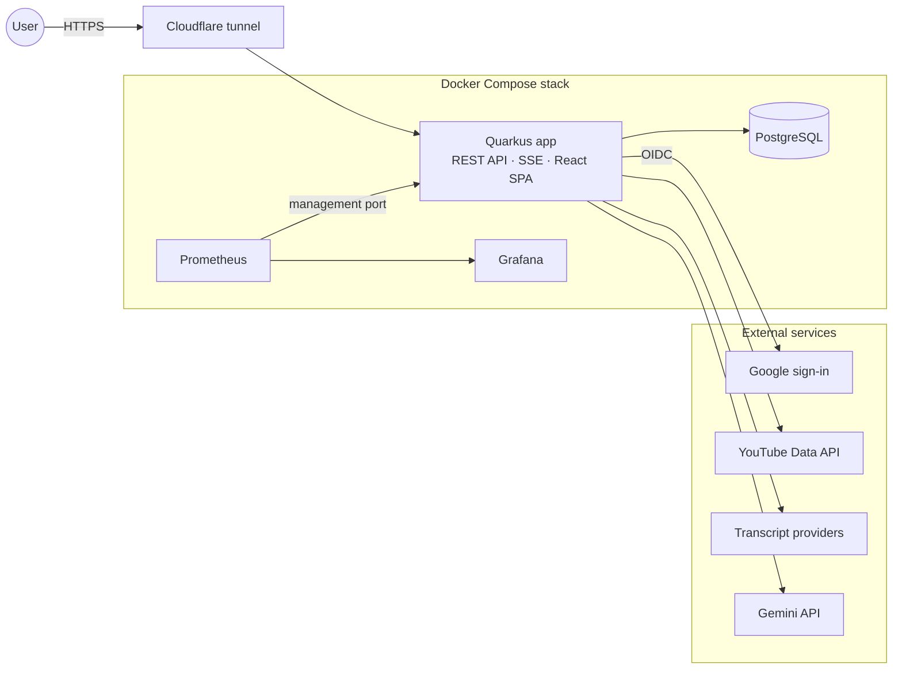

# Povzetkar

**Your YouTube channels. One daily briefing.** Povzetkar follows the YouTube channels you choose, summarizes every
new video with Gemini, and composes one daily briefing per topic — hours of video, minutes of reading.

· Live: [povzetkar.juresa.si](https://povzetkar.juresa.si)

<picture>
  <source media="(prefers-color-scheme: dark)" srcset="docs/images/landing-dark.png">
  
</picture>

## What it does

Following a handful of YouTube channels means hours of video a day. Povzetkar watches them for you: you group the
channels you care about into topics, and every day each topic gets one briefing — the day's essentials first, then a
short summary of every new video with a link to the original.

- **Topics and channels** — each user groups YouTube channels into topics, optionally with a custom summary prompt.
- **Automatic pipeline** — every hour new videos are fetched, their transcripts retrieved through a chain of
  providers with fallback, and each video summarized by Gemini; each topic gets a daily briefing with an
  executive summary on top.
- **Reading and sharing** — a searchable briefing library, Markdown/HTML export, and public share links for single
  briefings or summaries.
- **Operations** — account approval (new users browse demo content until approved), a background-job dashboard
  with restart and audit trail, content management, GenAI usage per API key, and a read-only API key for
  automation agents.
- **English and Slovenian**, light and dark themes.

## Architecture

One Quarkus application (Java 25) serves the REST API, Server-Sent Events and the React single-page application,
built into a single container image. The Cloudflare tunnel is the only public entry; the technical endpoints
(metrics, health, OpenAPI) live on a separate management port inside the Docker network. Details:
[architecture overview](docs/overview/architecture_overview.md) and the
[architecture decision records](docs/adr/).

## Tech stack

| Layer | Technology |
|---|---|
| Backend | Java 25, Quarkus 3 (REST, Hibernate ORM with Panache, OIDC, Scheduler, Micrometer), Flyway |
| AI | Google Gemini via the `google-genai` SDK, pooled API keys with a circuit breaker |
| Frontend | React 19, TypeScript, Vite, Tailwind CSS 4, TanStack Router and Query, Zustand, i18next, orval-generated API client |
| Data | PostgreSQL 17 (`pgvector` image) |
| Transcript proxy | Python, FastAPI (standalone service, `transcript-proxy/`) |
| Delivery | Multi-stage Docker image on distroless Java, Docker Compose, Cloudflare Tunnel, Prometheus, Grafana |
| Quality | JUnit 5, Mockito, Vitest, Playwright, SpotBugs, Trivy, GitHub Actions |

## Engineering highlights

- **Security** — Google OIDC with permission-based access control and per-user data scoping; an enforced
  Content-Security-Policy for the React SPA (inline script allowed only by hash, no `eval`; the legacy server-rendered
  admin pages allow inline scripts) and security headers sent by the app itself; forwarded headers trusted only from the tunnel connector; technical endpoints off the public port; a
  strictly read-only API key; secrets only from the environment, validated at startup.
- **Supply chain** — Trivy scans the dependencies and the built image on every CI run; the scanner action is pinned
  to a release commit SHA; every `.trivyignore` entry carries a rationale and an expiry date.
- **Tests** — as of v0.20.0: 646 backend tests (JUnit; persistence and transactions against a real PostgreSQL,
  business logic with persistence mocked), 151 Vitest tests, Playwright
  end-to-end specs also run against the production build under the strict CSP; a test fails the build when
  `application.properties` contains a configuration key Quarkus would silently ignore.
- **Traceability** — 38 user stories, 18 use cases and 63 test cases linked by ID; every task walkthrough declares
  its US/UC/TC references; `scripts/qa/validate-planning.py` checks the chain in CI.
- **Resilience** — transcripts from an ordered provider chain with fallback, paced and serialized YouTube fetches,
  bounded retries per video, a time budget per run, and a lock per date against overlapping runs.
- **Observability** — Prometheus metrics with bounded tag cardinality, provisioned Grafana dashboards, an access
  log designed as forensic evidence (trusted fields first, client-controlled fields after the status), and
  correlation IDs from request to background job.

## How it was built

Povzetkar is developed by the author together with an AI coding agent working under explicit, versioned
protocols — the agent proposes, the author approves. Every task follows the same path:

1. **Brainstorm** — a scope interview; the task definition is approved by the product owner (the author).
2. **Plan** — an evidence-based plan with design justification and a breaking-changes analysis; nothing is
   executed before explicit approval.
3. **Execute** — test-first for behaviour changes; the full test suite of every touched layer runs before a commit.
4. **Review** — a pre-commit code review of the whole task diff (plus a security review where relevant), then a
   pull-request review loop with a review bot; green CI is required for every merge.
5. **Close-out** — a walkthrough (what was done, deviations, traceability) and a note in the version retrospective
   whose feed-forward the next task reads.

The rules live in [`AGENT.md`](AGENT.md) and [`docs/protocols/`](docs/protocols/); the phase-level process in the
[development checklist](docs/sdlc/11_development_checklist.md). As of v0.20.0 the project has 2,099 commits since
July 2025, 290 merged pull requests, 25 release tags, 12 architecture decision records, and 31 task walkthroughs
with retrospectives (task-level records since v0.18). An example pair: the
[POV-214 walkthrough](docs/versions/v0.20.0/POV-214-walkthrough.md) and
[retrospective](docs/versions/v0.20.0/POV-214-retrospective.md) — moving the security headers into the
application when the Cloudflare tunnel turned out to bypass the reverse proxy
([ADR-0012](docs/adr/0012-cloudflare-tunnel-only-edge.md)).

## Repository map

| Path | Content |
|---|---|
| [`backend/`](backend/) | Quarkus application, compose files, monitoring configuration |
| [`frontend/`](frontend/) | React SPA |
| [`transcript-proxy/`](transcript-proxy/) | Standalone transcript proxy (FastAPI) |
| [`docs/`](docs/) | Runbook, architecture, requirements and traceability, protocols, version records — see [project structure](docs/overview/project-structure.md) |
| [`scripts/`](scripts/) | Release and QA tooling (planning validator, link checker, infra-config validation) |
| [`CHANGELOG.md`](CHANGELOG.md) | Release notes |

## Run locally

You need JDK 25, Node.js 24, Docker, a Google OAuth client (OIDC), a YouTube Data API key and a Gemini API key.
In short: fill `backend/.env` from `backend/.env.example`; in `backend/`, create the two database volumes once
(`docker volume create povzetkar_postgres_dev_data` and `… povzetkar_postgres_test_data`) and start the dev
database with `docker compose up -d`; then run `../mvnw quarkus:dev -DskipTests=true` in `backend/` and
`npm run dev` in `frontend/`. The
[RUNBOOK](docs/RUNBOOK.md) has the full setup, tests and container build.

## Notes

- `POV-…` identifiers in commits and documents refer to issues in a private tracker.
- Security issues: see [SECURITY.md](SECURITY.md).

## License

© 2025–2026 Simon Juresa. All rights reserved. The source is published for review. You may clone and run it locally
to evaluate my work; any other use, including hosting it as a service, requires my written permission.
