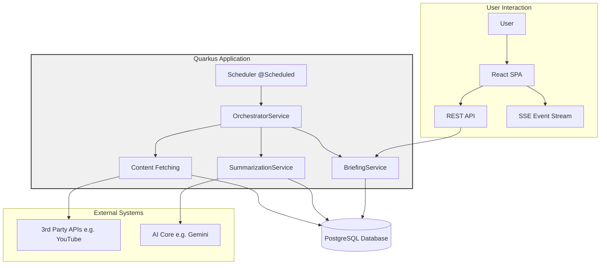

# Architecture Overview (v0.13)

**Version:** 1.2
**Date:** March 19, 2026

## Revision History

| Version | Date               | Author       | Changes                                                                                             |
|---------|--------------------|--------------|-----------------------------------------------------------------------------------------------------|
| 1.2     | March 19, 2026     | Antigravity  | Updated to reflect the React-based SPA architecture and new Platform Foundations (i18n, Theme).      |
| 1.1     | November 1, 2025   | Povzetkar AI | Overhauled document to reflect the final v0.6 architecture, replacing Git publishing with the new UI. |
| 1.0     | September 10, 2025 | Povzetkar AI | Initial version of the architecture overview.                                                       |

## 1. Executive Summary

This document outlines the simplified, autonomous architecture for the Povzetkar project as of version 0.6. The previous hybrid architecture, which relied on a legacy application, has been fully decommissioned.

The system now operates as a single, self-contained **Quarkus application**. This application is responsible for the entire intelligence-gathering workflow and makes the results available for review through a simple web interface, replacing the previous Git-based publishing mechanism.

## 2. System Architecture

The architecture consists of a single, modular Quarkus application that handles all aspects of the workflow, from data ingestion to user presentation.

### Components

1.  **Scheduler (`@Scheduled`)**: The entry point of the automated workflow. It triggers the `OrchestratorService` at a configurable interval.

2.  **OrchestratorService**: The central coordinator. It manages the end-to-end process:
    *   Invokes the **Content Fetching** logic to find new items.
    *   Invokes the **SummarizationService** for each new item.
    *   Invokes the **BriefingService** once summaries for a given day are ready.

3.  **Content Fetching**: A set of services responsible for interacting with third-party APIs (like YouTube) to retrieve new content items and storing them in the database.

4.  **SummarizationService**: Fetches video transcripts and uses a GenAI service to produce summaries. It handles the status and error-handling logic for individual content items, storing results in the database.

5.  **BriefingService**: Aggregates individual summaries from the database into a coherent daily briefing for a specific topic.

6.  **React SPA & REST API**: A modern Single Page Application (Vite, React, Tailwind 4) that allows users to browse generated briefings, manage topics, and monitor system status. It features:
    *   **Platform Foundations**: Integrated Theme switching (Dark/Light/System) and i18n support (English/Slovenian).
    *   **User Profile**: Dedicated route (`/me`) for managing user identity and preferences.
    *   **Real-time Updates**: SSE-powered job monitoring and notifications.

## 3. Data Flow

1.  The **Scheduler** initiates the process.
2.  The **Orchestrator** triggers **Content Fetching**, which finds new videos and creates `ContentItem` records in the **PostgreSQL Database**.
3.  The **SummarizationService** is called for each new item. It fetches transcripts, sends them to the **GenAI Service**, and stores the resulting `Summary` in the database.
4.  Once summaries for a given day are complete, the **Orchestrator** calls the **BriefingService**.
5.  The **BriefingService** queries the database for recent summaries and creates a `Briefing` record.
6.  The generated `Briefing` is now available in the database and can be viewed by a user through the **Simple Web UI**.

## 4. Decommissioning of Legacy App

As of this version, the legacy Java application is fully decommissioned. Its responsibilities have been entirely migrated to the Quarkus application. This change significantly simplifies the deployment, monitoring, and maintenance of the system.
