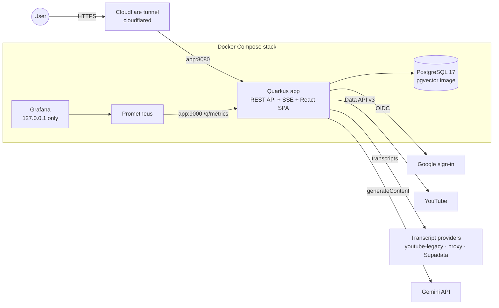

# Architecture Overview

Current architecture of Povzetkar as of v0.20.0. Decisions behind it are in [`docs/adr/`](../adr/); operational
procedures in the [RUNBOOK](../RUNBOOK.md).

## 1. Summary

Povzetkar turns a user's YouTube channels into one daily briefing per topic. A single **Quarkus** application
(Java 25) fetches new videos, retrieves their transcripts, summarizes each with **Gemini**, and composes the
summaries into a daily briefing. A **React** single-page application, built into the same container image and
served by Quarkus, is the user interface. **PostgreSQL** holds all state. In production the application sits behind
a **Cloudflare tunnel**, its only public entry ([ADR-0012](../adr/0012-cloudflare-tunnel-only-edge.md)), with
**Prometheus** and **Grafana** for metrics.

## 2. System context

- **Edge:** TLS ends at Cloudflare; no host port is published for public traffic. The app sends its own security
  headers and Content-Security-Policy and trusts `X-Forwarded-*` only from `cloudflared`'s fixed address.
- **Management interface:** `/q/metrics`, `/q/health`, `/q/openapi` are served only on port 9000 inside the Docker
  network (`quarkus.management.enabled=true`); port 8080 answers 404 for them.
- **Authentication:** Google OIDC (`quarkus-oidc`, browser session) and an optional read-only API key
  (`X-API-Key`) for automation; permissions are derived from roles (`RolePermissionsMap`).

## 3. Backend (`backend/`, package `com.povzetkar.quarkus`)

| Area | Responsibility | Key classes |
|---|---|---|
| Orchestration | Scheduled and manual runs: fetch new items per topic, summarize them just in time, generate the briefing; per-date lock, time budget | `OrchestrationManager`, `TopicProcessor`, `OrchestrationLockService`, `JustInTimeSummarizationScheduler` |
| Content fetching | YouTube Data API: new videos per channel, channel resolution and enrichment | `YouTubeContentFetcherService`, `YouTubeFetchingStrategy`, `YouTubeDetailEnrichmentStrategy` |
| Transcripts | Ordered provider chain with fallback, paced YouTube fetches, bounded retries per video | `TranscriptOrchestrator`, `YouTubeLegacyTranscriptProvider`, `ProxyTranscriptProvider`, `SupadataTranscriptProvider`, `YouTubeRequestPacer`, `TranscriptRetryPolicy` |
| Summarization | Prompt templating and Gemini calls through a pool of API keys with a circuit breaker on repeated 503s | `VideoSummaryService`, `YouTubeSummarizationStrategy`, `GenAiPool`, `GenAiClient` |
| Briefings | Daily briefing per topic from the day's summaries, idempotent | `BriefingService`, `DefaultBriefingGenerator` |
| REST API | `/api/v1/*` resources, response envelope, RFC 7807 errors, optimistic locking (`If-Match`), idempotency keys | `api.*ApiResource`, `api.filter.*`, `api.exceptionmapper.*` |
| Real time | Server-Sent Events for job status | `EventBroadcaster`, `EventApiResource` |
| Background jobs | Job records, audit trail, retention | `BackgroundJobService`, `RetentionService` |
| Security | OIDC identity augmentation, API-key mechanism, read-only policy, XHR-aware 401 | `security.*` |
| Legacy UI | Server-rendered Qute pages under `/ui/*`, admin-only | `ui.*` |

Scheduled jobs (`application.properties`): orchestration hourly, job-audit retention daily, source enrichment
weekly. Persistence is Hibernate ORM with Panache; the schema is owned by Flyway (`db/migration`, Java migrations in
`db.migration`). The `pgvector` extension is enabled and V1 reserves an `embedding` column, which no code uses yet.

## 4. Frontend (`frontend/`)

React 19 + TypeScript, built with Vite 6 and styled with Tailwind CSS 4. TanStack Router (code-split routes) and
TanStack Query; the API client is generated from the backend's OpenAPI document with orval, and CI fails when it
drifts. Zustand for client state, i18next for English and Slovenian, light/dark themes applied before first paint.
The production build is copied into the Quarkus image (`Dockerfile`, multi-stage) and served same-origin, so the
SPA needs no CORS.

## 5. Transcript proxy (`transcript-proxy/`)

A standalone FastAPI service that fetches one transcript per request from a host whose IP YouTube does not block.
The backend calls it as the `proxy` provider (`TRANSCRIPT_PROXY_URL`, `TRANSCRIPT_PROXY_API_KEY`); see its
[README](../../transcript-proxy/README.md).

## 6. Data flow of a scheduled run

1. The scheduler fires the orchestration; a lock per date prevents overlapping runs on the same day.
2. For each enabled topic, new videos of its channels are fetched and stored as content items (too-short videos
   are skipped).
3. Each pending item gets a transcript from the first provider in `transcript.providers.order` that succeeds;
   YouTube fetches are paced app-wide and failed items are retried later within a bounded budget.
4. The transcript is stored, then summarized by Gemini; the summary is stored.
5. Yesterday's briefing per topic is generated from its summaries (skipped when already up to date).
6. Job status changes are pushed to connected browsers via SSE; metrics go to Prometheus.

## 7. Build, test and delivery

- One multi-stage `Dockerfile`: frontend build (Node 24), backend build (Temurin 25), a static Go healthcheck,
  runtime on distroless Java 25.
- CI (`.github/workflows/ci.yml`): planning-traceability audit, generated-client drift check, backend and frontend
  unit tests, Playwright end-to-end tests, `mvn verify` with SpotBugs, Trivy filesystem scan, infra-config
  validation, image build and Trivy image scan.
- Production runs `backend/docker-compose.prod.yml`: app, PostgreSQL, Prometheus, Grafana, `cloudflared`.
