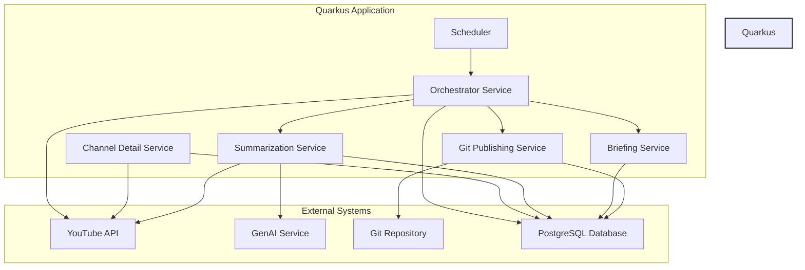

# Architecture Overview (v0.6)

**Version:** 1.0
**Date:** September 10, 2025
**Author:** Povzetkar AI

## 1. Executive Summary

This document outlines the simplified, autonomous architecture for the Povzetkar project as of version 0.6. The previous hybrid architecture, which relied on a legacy application for orchestration, has been fully decommissioned.

The system now operates as a single, self-contained **Quarkus application**. This application is responsible for the entire intelligence-gathering and content-generation workflow, from data ingestion to final publication.

## 2. System Architecture

The architecture consists of a single, modular Quarkus application that handles all aspects of the workflow.

### Components

1.  **Scheduler (`@Scheduled`)**: The entry point of the automated workflow. It triggers the `Orchestrator Service` at a configurable interval.

2.  **Orchestrator Service**: The central coordinator. It manages the end-to-end process for each topic:
    *   Fetches new content items.
    *   Invokes the `Summarization Service` for each item (in parallel).
    *   Invokes the `Briefing Service` once all summaries are complete.
    *   Invokes the `Git Publishing Service` to publish the final output.

3.  **Channel Detail Service**: Responsible for enriching and refreshing channel metadata from the YouTube API and storing it in the database. This service is triggered periodically on its own schedule.

4.  **Summarization Service**: Fetches video transcripts from YouTube and uses a GenAI service to produce summaries. It handles the status and error-handling logic for individual content items, storing results in the database.

5.  **Briefing Service**: Aggregates individual summaries from the database into a coherent daily briefing.

6.  **Git Publishing Service**: Generates the final Markdown output for a briefing by reading briefing data from the database, and publishes it to the appropriate Git repository using JGit.

## 3. Data Flow

1.  The **Scheduler** initiates the process.
2.  The **Orchestrator** fetches new videos for each topic, creating `ContentItem` records in the **PostgreSQL Database**.
3.  The **Summarization Service** is called for each new item (in parallel). It fetches transcripts from YouTube, sends them to the **GenAI Service**, and stores the resulting `Summary` in the database.
4.  Once all summaries for the batch are complete, the **Orchestrator** calls the **Briefing Service**.
5.  The **Briefing Service** queries the database for recent summaries and creates a `Briefing` record.
6.  Finally, the **Orchestrator** calls the **Git Publishing Service**, which generates a Markdown file from the briefing data and pushes it to the target **Git Repository**.

## 4. Decommissioning of Legacy App

As of this version, the legacy Java application is fully decommissioned. Its responsibilities have been entirely migrated to the Quarkus application. This change significantly simplifies the deployment, monitoring, and maintenance of the system.
