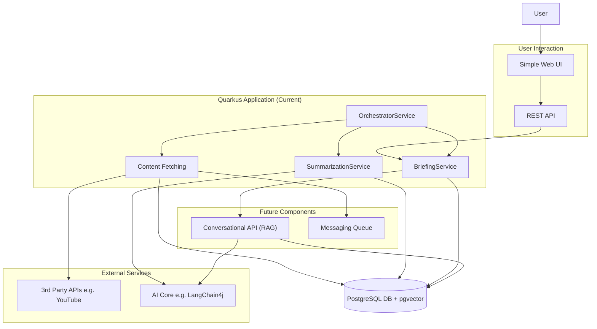

# Project Povzetkar — Original Vision (October 2025)

> [!NOTE]
> **Historical vision, not the current design.** This specification describes the long-term vision as written in
> October 2025 (multi-source ingestion, RAG chat, trend and bias analysis, LangChain4j, a message queue). Much of it
> is not built, and the stack evolved differently — Gemini through the `google-genai` SDK, no LangChain4j, no message
> queue. The current architecture is in [architecture_overview.md](architecture_overview.md); planned work is in the
> [roadmap](roadmap.md) and the [backlog](../backlog/improvements.md).

**Version:** 1.1
**Date:** October 31, 2025

## 1.0 Executive Summary

Project Povzetkar aims to be an automated intelligence platform that ingests, analyzes, and synthesizes content from a wide array of digital sources. The system will evolve from its current state as a YouTube-focused summarization tool into a multi-source platform featuring advanced AI capabilities, including trend analysis, sentiment detection, and a conversational, RAG-powered user interface.

This document proposes a modern, scalable, and cloud-native architecture built on a foundation of high-performance Java, robust data persistence, and asynchronous processing. The recommended technology stack, centered around **Quarkus** and **LangChain4j**, is chosen to maximize developer productivity, operational efficiency, and future-readiness.

## 2.0 System Architecture

A modular, service-oriented architecture is recommended to ensure scalability, maintainability, and the ability to independently develop and deploy different components of the system.

### 2.1 High-Level Architectural Diagram

The system is designed as a monolithic, autonomous Quarkus application that handles the entire workflow from content fetching to user presentation. It follows a modular, service-oriented architecture that will evolve to include decoupled services and advanced user interfaces.

### 2.2 Technology Stack Recommendation

*   **Backend Framework:** **Quarkus**. Chosen for its extremely fast startup times, low memory footprint, superior developer experience (live reload), and first-class support for native compilation with GraalVM. This makes it ideal for efficient, cost-effective deployment in containers.
*   **AI Orchestration:** **LangChain4j** with `quarkus-langchain4j` extensions. This provides a powerful, vendor-agnostic abstraction over AI models (Gemini, OpenAI, etc.) and offers best-in-class, declarative support for RAG, which is central to the project's vision.
*   **Database:** **PostgreSQL** with the **`pgvector`** extension. A robust, open-source relational database that, with `pgvector`, becomes a powerful and integrated solution for storing both structured data and the vector embeddings required for RAG.
*   **Messaging Queue:** **RabbitMQ** or **Apache Kafka**. (Future) To decouple data ingestion from processing. This makes the system resilient to failures and allows for independent scaling of ingestion and processing workloads.
*   **Containerization:** **Docker**. The entire application, including the backend services and database, will be containerized for consistent development, testing, and production environments.
*   **Deployment Orchestration:** **Docker Compose** (for local development/simple deployments) or **Kubernetes** (for production-grade, scalable deployments).

## 3.0 Core Modules & Services

### 3.1 Data Ingestion Layer

This layer consists of services responsible for fetching raw content.
*   **Content Fetching Service:** Fetches new content (currently from YouTube) for all tracked sources.
*   **(Future) Web Scraper Service:** A new service responsible for crawling and extracting textual content from specified websites and blogs.
*   **(Future) Social Media Service(s):** Dedicated modules for interacting with the APIs of platforms like X, Reddit, etc.

### 3.2 Content Processing & Enrichment Service

This is a background worker that performs the core AI tasks.
*   **SummarizationService:** Generates a concise summary for each piece of content.
*   **BriefingService:** Aggregates summaries into a daily briefing for a specific topic, including a meta-summary.
*   **(Future) Categorization:** Uses an LLM to assign one or more predefined categories to each summary.
*   **(Future) Sentiment Analysis:** Determines the overall sentiment (positive, negative, neutral) of the content.
*   **(Future) Trend & Pattern Detection:** Periodically analyzes aggregated summaries to identify emerging topics, keywords, and patterns.
*   **(Future) Embedding Generation:** Creates vector embeddings for all processed content and summaries, storing them in the `pgvector` database for RAG.

### 3.3 Persistence Layer (Data Model)

A normalized PostgreSQL schema stores all application data.
*   `users`, `topics`: Manages multi-tenancy and user-specific content.
*   `content_sources`, `content_items`: Stores metadata about each piece of ingested content.
*   `summaries`: The generated summaries, linked to `content_items`. This table will eventually include the vector embedding column.
*   `briefings`: Stores the aggregated periodic briefings.
*   **(Future) `trends`, `categories`, `sentiments`**: Tables to store the results of the analysis.

### 3.4 RAG & Conversational API

This is a future user-facing backend service.
*   **Function:** It will expose a REST/WebSocket API for a frontend. When a user asks a question, the API will use LangChain4j to:
    1.  Convert the user's question into a vector embedding.
    2.  Query the `pgvector` store to find the most relevant summaries/documents.
    3.  Inject these relevant documents as context into a prompt for the LLM.
    4.  Return the LLM's context-aware answer to the user.
*   **Technology:** Built with Quarkus using JAX-RS for REST endpoints.

### 3.5 Content Generation Module

This future module will be triggered manually or automatically to create new content.
*   **Function:** It will take a set of summaries or a full briefing as input and use a specifically designed prompt to generate new artifacts like blog posts, a series of tweets, or a presentation outline.

## 4.0 Deployment & Operations

The entire system is designed for container-based deployment.
*   **Local Development:** A `docker-compose.yml` file defines and links all services (backend, database) for a one-command local environment setup.
*   **Production:** The services will be built as optimized native executables (using Quarkus) and packaged into minimal Docker images. These can be deployed to any cloud provider using Kubernetes for orchestration, auto-scaling, and high availability.

## 5.0 Phased Development Roadmap

The development is executed in phases as defined in the official `roadmap.md` document. The high-level goals are:
*   **Foundation & Migration (Completed):** Migrate the legacy logic to a new, autonomous Quarkus application with a robust database backend.
*   **Standalone Deployment & Hardening:** Package the application for production-like deployments and enhance it with monitoring and a UI-facing API.
*   **RAG & Conversational Interface:** Deliver the core "interactive report" feature with an advanced user interface.
*   **Expansion & Advanced Analytics:** Broaden the platform's intelligence-gathering capabilities by adding new data sources and analytical features.
*   **Content Creation & Refinement:** Evolve the platform from an analysis tool to a content creation partner.
