# Database Design Document - Project Povzetkar

**Version:** 1.4

## Revision History

| Version | Date               | Author       | Changes                                          |
|---------|--------------------|--------------|--------------------------------------------------|
| 1.4     | September 15, 2025 | Povzetkar AI | Introduced User entity, made Topic multi-tenant. |
| 1.3     | September 10, 2025 | Povzetkar AI | Aligned terminology (Report -> Briefing).        |
| 1.2     | September 2, 2025  | Povzetkar AI | Replaced Author with Channel and added Topic.    |
| 1.1     | August 27, 2025    | Povzetkar AI | Added `RETRY_LATER` to `processing_status_enum`. |
| 1.0     | August 15, 2025    | Povzetkar AI | Initial version of the database design.          |

## 1. Introduction

This document describes the database schema for the Povzetkar project. The chosen database is **PostgreSQL** with the **`pgvector`** extension to support both structured data and vector embeddings efficiently.

## 2. Entity-Relationship (ER) Diagram

This diagram shows the high-level relationships between the core entities in the system.

```mermaid
erDiagram
    USERS ||--|{ TOPICS : "owns"
    TOPICS ||--|{ CHANNEL_TOPICS : "is part of"
    CHANNELS ||--|{ CHANNEL_TOPICS : "contains"
    CHANNELS ||--o{ CONTENT_ITEMS : "publishes"
    CONTENT_ITEMS ||--o{ SUMMARIES : "is summarized by"
    CATEGORIES ||--o{ SUMMARIES : "categorizes"
    SENTIMENTS ||--o{ SUMMARIES : "describes"
    BRIEFINGS ||--|{ BRIEFING_SUMMARIES : "aggregates"
    SUMMARIES ||--|{ BRIEFING_SUMMARIES : "is part of"
    TRENDS ||--|{ TREND_SUMMARIES : "is composed of"
    SUMMARIES ||--|{ TREND_SUMMARIES : "contributes to"
    SOURCE_TYPES ||--o{ CONTENT_ITEMS : "is of type"
    CHANNELS ||--o{ CHANNEL_ASSESSMENTS : "is assessed for"

    USERS {
        bigint id PK
        boolean active
        varchar name
    }

    TOPICS {
        bigint id PK
        bigint user_id FK
        varchar name
        timestamp created_at
    }

    CHANNELS {
        bigint id PK
        varchar source_channel_id
        int source_type_id FK
        varchar name
        text description
        integer subscriber_count
        timestamp created_at
    }

    CHANNEL_TOPICS {
        bigint channel_id PK, FK
        bigint topic_id PK, FK
    }

    CONTENT_ITEMS {
        bigint id PK
        bigint channel_id FK
        varchar source_url UK
        int source_type_id FK
        text raw_content
        timestamp published_at
        processing_status_enum processing_status
        integer duration_seconds
        timestamp created_at
    }

    SUMMARIES {
        bigint id PK
        bigint content_item_id FK
        text summary_text
        vector(1536) embedding "NOT NULL"
        int category_id FK
        int sentiment_id FK
        timestamp created_at
    }
    
    BRIEFINGS {
        bigint id PK
        varchar title
        text meta_summary
        date briefing_date
        timestamp created_at
    }
    
    CATEGORIES {
        int id PK
        varchar name UK
    }

    BRIEFING_SUMMARIES {
        bigint briefing_id PK, FK
        bigint summary_id PK, FK
    }

    SENTIMENTS {
        int id PK
        varchar name UK
    }

    SOURCE_TYPES {
        int id PK
        varchar name UK
    }

    TRENDS {
        bigint id PK
        varchar name
        text description
        date start_date
        date end_date
        timestamp created_at
    }

    TREND_SUMMARIES {
        bigint trend_id PK, FK
        bigint summary_id PK, FK
    }

    CHANNEL_ASSESSMENTS {
        bigint id PK
        bigint channel_id FK
        decimal bias_score
        text assessment_details
        timestamp created_at
    }
```

## 3 Custom Data Types

To ensure data integrity, the schema uses custom PostgreSQL `ENUM` types for certain columns.

### `processing_status_enum`
A type to represent the processing state of a content item.
- **SQL Definition:** `CREATE TYPE processing_status_enum AS ENUM ('PENDING', 'COMPLETED', 'FAILED', 'RETRY_LATER');`
- **Values:**
    - `PENDING`: The item has been ingested but not yet processed.
    - `COMPLETED`: The item has been successfully processed (summarized, embedded, etc.).
    - `FAILED`: An unrecoverable error occurred during processing.
    - `RETRY_LATER`: A transient, recoverable error occurred (e.g., transcript not yet available). The system should re-attempt processing later.

## 4. Table Definitions

### `users`
Stores user accounts that own topics and other resources.
- `id` (PK, bigint, auto-increment): `NOT NULL`
- `active` (boolean): Whether the user account is active. `NOT NULL DEFAULT TRUE`
- `name` (varchar): The name of the user. `NOT NULL`

### `topics`
A lookup table for content topics or categories, owned by a user.
- `id` (PK, bigint, auto-increment): `NOT NULL`
- `user_id` (FK, bigint): References `users.id`. `NOT NULL`
- `name` (varchar): The name of the topic (e.g., 'ai', 'crypto'). `NOT NULL`
- **Constraints**: `UNIQUE (user_id, name)`
- `created_at` (timestamp): When the topic was created. `NOT NULL DEFAULT CURRENT_TIMESTAMP`

### `channels`
Stores information about content channels (e.g., YouTube channels).
- `id` (PK, bigint, auto-increment): `NOT NULL`
- `source_channel_id` (varchar): The unique identifier for the channel on the source platform (e.g., YouTube channel ID). `NOT NULL`
- `source_type_id` (FK, int): References `source_types.id`. `NOT NULL`
- **Constraints**: `UNIQUE (source_channel_id, source_type_id)`
- `name` (varchar): The channel's name. `NOT NULL`
- `description` (text): The channel's description. `NULL`
- `subscriber_count` (integer): `NOT NULL DEFAULT 0`
- `created_at` (timestamp): When the author was first added to the system. `NOT NULL DEFAULT CURRENT_TIMESTAMP`

### `channel_topics`
A join table creating a many-to-many relationship between channels and topics.
- `channel_id` (PK, FK, bigint): References `channels.id`. `NOT NULL`
- `topic_id` (PK, FK, bigint): References `topics.id`. `NOT NULL`
This table facilitates the many-to-many relationship between `topics` and `channels`. For JPA implementations, `Topic` is considered the owning side of this relationship, meaning the `Topic` entity will manage the join table (e.g., by holding the `@JoinTable` annotation). This aligns with the use case of querying channels associated with a specific topic.

### `content_items`
Stores raw ingested content from various sources.
- `id` (PK, bigint, auto-increment): `NOT NULL`
- `channel_id` (FK, bigint): References `channels.id`. `NOT NULL`
- `source_url` (varchar, unique): The canonical URL of the content. `NOT NULL`
- `source_type_id` (FK, int): References `source_types.id`. `NOT NULL`
- `raw_content` (text): The full transcript or article text. `NOT NULL`
- `published_at` (timestamp): The original publication date of the content. `NOT NULL`
- `processing_status` (processing_status_enum): The current state of the item. `NOT NULL DEFAULT 'PENDING'`
- `duration_seconds` (integer): Duration for video/audio content. `NULL`
- `created_at` (timestamp): When the item was ingested. `NOT NULL DEFAULT CURRENT_TIMESTAMP`

### `summaries`
Stores the AI-generated summaries and their vector embeddings.
- `id` (PK, bigint, auto-increment): `NOT NULL`
- `content_item_id` (FK, bigint): References `content_items.id`. `NOT NULL`
- `summary_text` (text): The generated summary in Markdown format. `NOT NULL`
- `embedding` (vector(1536)): The vector representation of the summary text. An index of type IVFFlat or HNSW should be created on this column for fast similarity searches. `NOT NULL`
- `category_id` (FK, int): References `categories.id`. `NULL`
- `sentiment_id` (FK, int): References `sentiments.id`. `NULL`
- `created_at` (timestamp): When the summary was generated. `NOT NULL DEFAULT CURRENT_TIMESTAMP`

### `briefings`
Stores aggregated periodic briefings.
- `id` (PK, bigint, auto-increment): `NOT NULL`
- `title` (varchar): The title of the report. `NOT NULL`
- `meta_summary` (text): The executive "meta-summary" of the report. `NOT NULL`
- `briefing_date` (date): The date the briefing pertains to. `NOT NULL`
- `created_at` (timestamp): When the briefing was generated. `NOT NULL DEFAULT CURRENT_TIMESTAMP`

### `categories`
A lookup table for content categories.
- `id` (PK, int, auto-increment): `NOT NULL`
- `name` (varchar, unique): The name of the category (e.g., 'Technology', 'Politics'). `NOT NULL`

### `sentiments`
A lookup table for sentiment values.
- `id` (PK, int, auto-increment): `NOT NULL`
- `name` (varchar, unique): The name of the sentiment (e.g., 'Positive', 'Negative', 'Neutral'). `NOT NULL`

### `source_types`
A lookup table for content source types.
- `id` (PK, int, auto-increment): `NOT NULL`
- `name` (varchar, unique): The name of the source type (e.g., 'YOUTUBE', 'BLOG', 'REDDIT'). `NOT NULL`

### `briefing_summaries`
A join table creating a many-to-many relationship between briefings and summaries. This allows a single summary to be part of multiple briefings (e.g., a daily and a weekly briefing).
- `briefing_id` (PK, FK, bigint): References `briefings.id`. `NOT NULL`
- `summary_id` (PK, FK, bigint): References `summaries.id`. `NOT NULL`
The primary key for this table is a composite key formed by (`briefing_id`, `summary_id`).

### `trends`
Stores identified trends and patterns from the analyzed content.
- `id` (PK, bigint, auto-increment): `NOT NULL`
- `name` (varchar): A concise name for the trend (e.g., "Rise of AI in Java"). `NOT NULL`
- `description` (text): A detailed explanation of the trend. `NOT NULL`
- `start_date` (date): The approximate date when the trend was first observed. `NOT NULL`
- `end_date` (date): The date the trend was last observed (can be null for ongoing trends). `NULL`
- `created_at` (timestamp): When the trend was first logged in the system. `NOT NULL DEFAULT CURRENT_TIMESTAMP`

### `trend_summaries`
A join table to create a many-to-many relationship between trends and the summaries that constitute them.
- `trend_id` (PK, FK, bigint): References `trends.id`. `NOT NULL`
- `summary_id` (PK, FK, bigint): References `summaries.id`. `NOT NULL`
The primary key for this table is a composite key formed by (`trend_id`, `summary_id`).

### `channel_assessments`
Stores historical records of bias assessments for content channels.
- `id` (PK, bigint, auto-increment): `NOT NULL`
- `channel_id` (FK, bigint): References `channels.id`. `NOT NULL`
- `bias_score` (decimal): A numerical score representing the detected bias (e.g., from -1.0 for negative to 1.0 for positive). `NOT NULL CHECK (bias_score >= -1.0 AND bias_score <= 1.0)`
- `assessment_details` (text): A detailed, AI-generated explanation for the given score. `NOT NULL`
- `created_at` (timestamp): When the assessment was performed. `NOT NULL DEFAULT CURRENT_TIMESTAMP`
