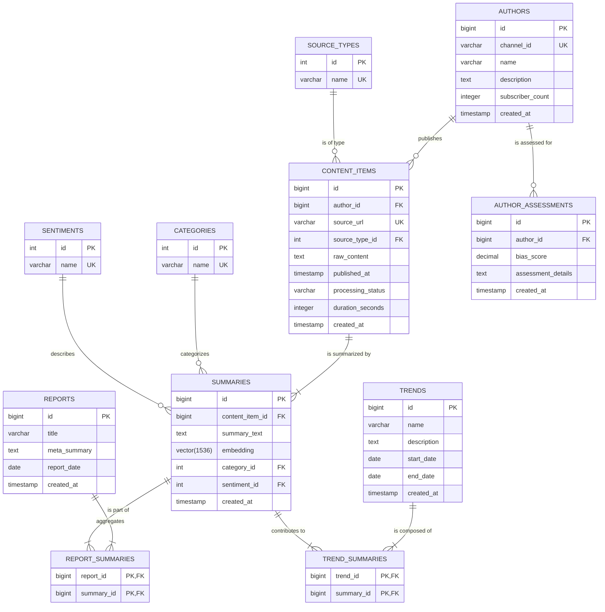

# Database Design Document - Project Povzetkar

**Version:** 1.0
**Date:** August 15, 2025

## 1. Introduction

This document describes the database schema for the Povzetkar project. The chosen database is **PostgreSQL** with the **`pgvector`** extension to support both structured data and vector embeddings efficiently.

## 2. Entity-Relationship (ER) Diagram

This diagram shows the high-level relationships between the core entities in the system.

## 3. Table Definitions

### `authors`
Stores information about content creators.
- `id` (PK, bigint, auto-increment): `NOT NULL`
- `channel_id` (varchar, unique): The unique identifier from the source platform (e.g., YouTube channel ID). `NOT NULL`
- `name` (varchar): The author's name. `NOT NULL`
- `description` (text): The author's channel/profile description. `NULL`
- `subscriber_count` (integer): `NOT NULL DEFAULT 0`
- `created_at` (timestamp): When the author was first added to the system. `NOT NULL DEFAULT CURRENT_TIMESTAMP`

### `content_items`
Stores raw ingested content from various sources.
- `id` (PK, bigint, auto-increment): `NOT NULL`
- `author_id` (FK, bigint): References `authors.id`. `NOT NULL`
- `source_url` (varchar, unique): The canonical URL of the content. `NOT NULL`
- `source_type_id` (FK, int): References `source_types.id`. `NOT NULL`
- `raw_content` (text): The full transcript or article text. `NOT NULL`
- `published_at` (timestamp): The original publication date of the content. `NOT NULL`
- `processing_status` (varchar): The current state of the item. e.g., 'PENDING', 'COMPLETED', 'FAILED'. `NOT NULL DEFAULT 'PENDING'`
- `duration_seconds` (integer): Duration for video/audio content. `NULL`
- `created_at` (timestamp): When the item was ingested. `NOT NULL DEFAULT CURRENT_TIMESTAMP`

### `summaries`
Stores the AI-generated summaries and their vector embeddings.
- `id` (PK, bigint, auto-increment): `NOT NULL`
- `content_item_id` (FK, bigint): References `content_items.id`. `NOT NULL`
- `summary_text` (text): The generated summary in Markdown format. `NOT NULL`
- `embedding` (vector): The vector representation of the summary text. An index of type IVFFlat or HNSW should be created on this column for fast similarity searches. `NULL`
- `category_id` (FK, int): References `categories.id`. `NULL`
- `sentiment_id` (FK, int): References `sentiments.id`. `NULL`
- `created_at` (timestamp): When the summary was generated. `NOT NULL DEFAULT CURRENT_TIMESTAMP`

### `reports`
Stores aggregated periodic reports.
- `id` (PK, bigint, auto-increment): `NOT NULL`
- `title` (varchar): The title of the report. `NOT NULL`
- `meta_summary` (text): The executive "meta-summary" of the report. `NOT NULL`
- `report_date` (date): The date the report pertains to. `NOT NULL`
- `created_at` (timestamp): When the report was generated. `NOT NULL DEFAULT CURRENT_TIMESTAMP`

### `categories`
A lookup table for content categories.
- `id` (PK, int, auto-increment): `NOT NULL`
- `name` (varchar, unique): The name of the category (e.g., 'Technology', 'Politics'). `NOT NULL`

### `sentiments`
A lookup table for sentiment values.
- `id` (PK, int, auto-increment): `NOT NULL`
- `name` (varchar, unique): The name of the sentiment (e.g., 'Positive', 'Negative', 'Neutral'). `NOT NULL`

### `source_types`
A lookup table for content source types.
- `id` (PK, int, auto-increment): `NOT NULL`
- `name` (varchar, unique): The name of the source type (e.g., 'YOUTUBE', 'BLOG', 'REDDIT'). `NOT NULL`

### `report_summaries`
A join table creating a many-to-many relationship between reports and summaries. This allows a single summary to be part of multiple reports (e.g., a daily and a weekly report).
- `report_id` (PK, FK, bigint): References `reports.id`. `NOT NULL`
- `summary_id` (PK, FK, bigint): References `summaries.id`. `NOT NULL`
The primary key for this table is a composite key formed by (`report_id`, `summary_id`).

### `trends`
Stores identified trends and patterns from the analyzed content.
- `id` (PK, bigint, auto-increment): `NOT NULL`
- `name` (varchar): A concise name for the trend (e.g., "Rise of AI in Java"). `NOT NULL`
- `description` (text): A detailed explanation of the trend. `NOT NULL`
- `start_date` (date): The approximate date when the trend was first observed. `NOT NULL`
- `end_date` (date): The date the trend was last observed (can be null for ongoing trends). `NULL`
- `created_at` (timestamp): When the trend was first logged in the system. `NOT NULL DEFAULT CURRENT_TIMESTAMP`

### `trend_summaries`
A join table to create a many-to-many relationship between trends and the summaries that constitute them.
- `trend_id` (PK, FK, bigint): References `trends.id`. `NOT NULL`
- `summary_id` (PK, FK, bigint): References `summaries.id`. `NOT NULL`
The primary key for this table is a composite key formed by (`trend_id`, `summary_id`).
