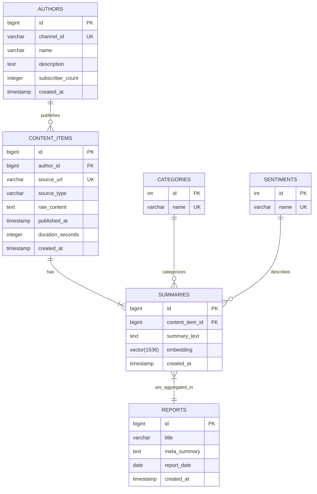

# Database Design Document - Project Povzetkar

**Version:** 1.0
**Date:** August 15, 2025

## 1. Introduction

This document describes the database schema for the Povzetkar project. The chosen database is **PostgreSQL** with the **`pgvector`** extension to support both structured data and vector embeddings efficiently.

## 2. Entity-Relationship (ER) Diagram

This diagram shows the high-level relationships between the core entities in the system.

## 3. Table Definitions

### `authors`
Stores information about content creators.
- `id` (PK, bigint, auto-increment)
- `channel_id` (varchar, unique): The unique identifier from the source platform (e.g., YouTube channel ID).
- `name` (varchar): The author's name.
- `description` (text): The author's channel/profile description.
- `subscriber_count` (integer)
- `created_at` (timestamp): When the author was first added to the system.

### `content_items`
Stores raw ingested content from various sources.
- `id` (PK, bigint, auto-increment)
- `author_id` (FK, bigint): References `authors.id`.
- `source_url` (varchar, unique): The canonical URL of the content.
- `source_type` (varchar): e.g., 'YOUTUBE', 'BLOG', 'REDDIT'.
- `raw_content` (text): The full transcript or article text.
- `published_at` (timestamp): The original publication date of the content.
- `duration_seconds` (integer): Duration for video/audio content.
- `created_at` (timestamp): When the item was ingested.

### `summaries`
Stores the AI-generated summaries and their vector embeddings.
- `id` (PK, bigint, auto-increment)
- `content_item_id` (FK, bigint): References `content_items.id`.
- `summary_text` (text): The generated summary in Markdown format.
- `embedding` (vector): The vector representation of the summary text. An index of type IVFFlat or HNSW should be created on this column for fast similarity searches.
- `category_id` (FK, int): References `categories.id`.
- `sentiment_id` (FK, int): References `sentiments.id`.
- `created_at` (timestamp): When the summary was generated.
