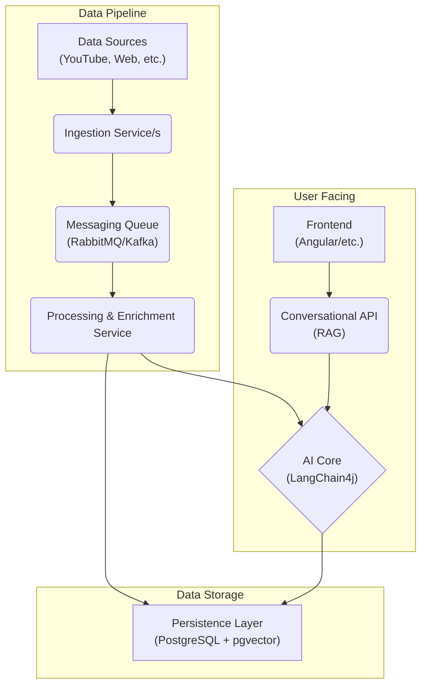

**Version:** 1.0
**Date:** August 15, 2025

## 1.0 Executive Summary

Project Povzetkar aims to be an automated intelligence platform that ingests, analyzes, and synthesizes content from a wide array of digital sources. The system will evolve from its current state as a YouTube-focused summarization tool into a multi-source platform featuring advanced AI capabilities, including trend analysis, sentiment detection, and a conversational, RAG-powered user interface.

This document proposes a modern, scalable, and cloud-native architecture built on a foundation of high-performance Java, robust data persistence, and asynchronous processing. The recommended technology stack, centered around **Quarkus** and **LangChain4j**, is chosen to maximize developer productivity, operational efficiency, and future-readiness.

## 2.0 System Architecture

A modular, service-oriented architecture is recommended to ensure scalability, maintainability, and the ability to independently develop and deploy different components of the system.

### 2.1 High-Level Architectural Diagram

### 2.2 Technology Stack Recommendation

*   **Backend Framework:** **Quarkus**. Chosen for its extremely fast startup times, low memory footprint, superior developer experience (live reload), and first-class support for native compilation with GraalVM. This makes it ideal for efficient, cost-effective deployment in containers.
*   **AI Orchestration:** **LangChain4j** with `quarkus-langchain4j` extensions. This provides a powerful, vendor-agnostic abstraction over AI models (Gemini, OpenAI, etc.) and offers best-in-class, declarative support for RAG, which is central to the project's vision.
*   **Database:** **PostgreSQL** with the **`pgvector`** extension. A robust, open-source relational database that, with `pgvector`, becomes a powerful and integrated solution for storing both structured data and the vector embeddings required for RAG.
*   **Messaging Queue:** **RabbitMQ** or **Apache Kafka**. To decouple data ingestion from processing. This makes the system resilient to failures and allows for independent scaling of ingestion and processing workloads.
*   **Containerization:** **Docker**. The entire application, including the frontend, backend services, and database, will be containerized for consistent development, testing, and production environments.
*   **Deployment Orchestration:** **Docker Compose** (for local development/simple deployments) or **Kubernetes** (for production-grade, scalable deployments).

## 3.0 Core Modules & Services

### 3.1 Data Ingestion Layer

This layer will consist of one or more services responsible for fetching raw content.
*   **YouTube Service:** Expands the existing functionality to fetch videos by both channel subscriptions and keyword search.
*   **Web Scraper Service:** A new service responsible for crawling and extracting textual content from specified websites and blogs.
*   **Social Media Service(s):** Dedicated modules for interacting with the APIs of platforms like X, Reddit, LinkedIn, and TikTok.
*   **Mechanism:** Upon finding new content, the service will publish a message to the Messaging Queue containing the content's metadata (e.g., URL, source, author).

### 3.2 Content Processing & Enrichment Service

This is a background worker that consumes messages from the queue and performs the core AI tasks.
*   **Summarization:** Generates a concise summary for each piece of content. For video, it will extract transcripts and generate summaries with timestamps.
*   **Categorization:** Uses an LLM to assign one or more predefined categories to each summary.
*   **Sentiment Analysis:** Determines the overall sentiment (positive, negative, neutral) of the content.
*   **Trend & Pattern Detection:** Periodically analyzes aggregated summaries to identify emerging topics, keywords, and patterns.
*   **Bias Detection:** A more advanced feature that analyzes an author's historical content to identify potential recurring biases.
*   **Embedding Generation:** Creates vector embeddings for all processed content and summaries, storing them in the `pgvector` database for RAG.

### 3.3 Persistence Layer (Data Model)

A normalized PostgreSQL schema will store all application data.
*   `content_items`: Stores metadata about each piece of ingested content (URL, source type, raw text, author_id, etc.).
*   `authors`: Information about content creators.
*   `summaries`: The generated summaries, linked to `content_items`. This table will include the vector embedding column managed by `pgvector`.
*   `reports`: Stores the aggregated periodic reports, including the executive "meta-summary".
*   `trends`, `categories`, `sentiments`, etc.: Tables to store the results of the analysis.

### 3.4 RAG & Conversational API

This is the user-facing backend service.
*   **Function:** It exposes a REST/WebSocket API for the frontend. When a user asks a question, the API uses LangChain4j to:
    1.  Convert the user's question into a vector embedding.
    2.  Query the `pgvector` store to find the most relevant summaries/documents.
    3.  Inject these relevant documents as context into a prompt for the LLM.
    4.  Return the LLM's context-aware answer to the user.
*   **Technology:** Built with Quarkus using JAX-RS for REST endpoints.

### 3.5 Content Generation Module

This module is triggered manually or automatically to create new content.
*   **Function:** It takes a set of summaries or a full report as input and uses a specifically designed prompt to generate new artifacts like blog posts, a series of tweets, or a presentation outline.

## 4.0 Deployment & Operations

The entire system is designed for container-based deployment.
*   **Local Development:** A `docker-compose.yml` file will define and link all services (backend, frontend, database, message queue) for a one-command local environment setup.
*   **Production:** The services will be built as optimized native executables (using Quarkus) and packaged into minimal Docker images. These can be deployed to any cloud provider using Kubernetes for orchestration, auto-scaling, and high availability.

## 5.0 Phased Development Roadmap

A phased approach is recommended to manage complexity and deliver value incrementally.

*   **Phase 1: Foundation & Migration (1-2 Months)**
    *   Migrate the existing `povzetkar` logic to a new Quarkus project.
    *   Replace the `processing_state.properties` file with the PostgreSQL database.
    *   Implement the YouTube Ingestion Service (authors & search) and the basic Processing Service (summarization only).
    *   Set up the initial `docker-compose` environment.
    *   **Goal:** Have a robust, database-backed version of the current functionality running in a modern architecture.

*   **Phase 2: RAG & Conversational Interface (2-3 Months)**
    *   Implement the `pgvector` storage and embedding generation in the Processing Service.
    *   Build the first version of the RAG & Conversational API.
    *   Develop a simple frontend application (e.g., Angular) with a chat interface to interact with the RAG API.
    *   **Goal:** Deliver the core "interactive report" feature.

*   **Phase 3: Expansion & Advanced Analytics (Ongoing)**
    *   Incrementally add new data sources (Web Scraper, X, Reddit).
    *   Implement sentiment analysis and categorization.
    *   Develop the first iteration of trend and pattern detection.
    *   **Goal:** Broaden the platform's intelligence-gathering capabilities.

*   **Phase 4: Content Creation & Refinement (Ongoing)**
    *   Build the Content Generation module.
    *   Implement the more complex features like bias detection and prediction accuracy tracking.
    *   Continuously refine models, prompts, and the user experience.
    *   **Goal:** Evolve the platform from an analysis tool to a content creation partner.
